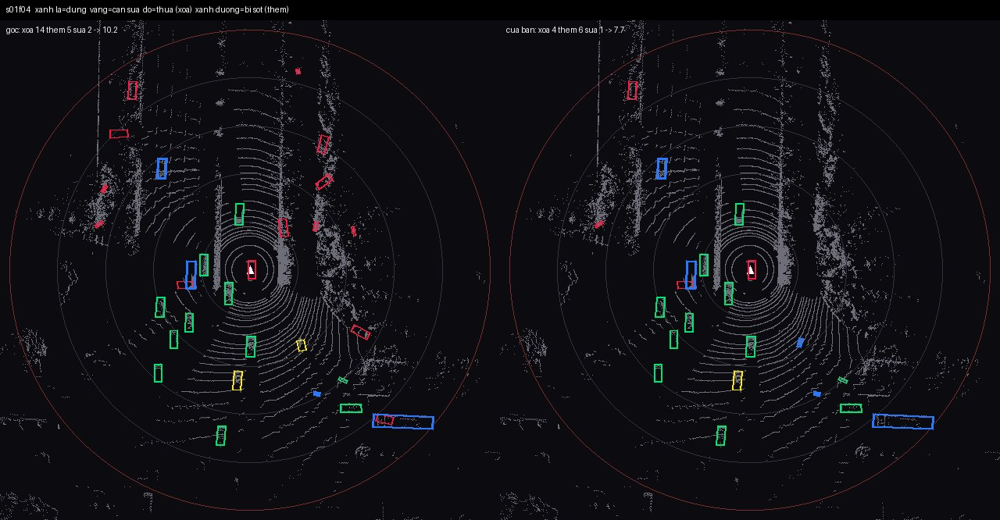

# Báo cáo Day 14 — Lê Duy Bảo — 2A202603257

> Sao chép file này thành `report/individual/<MSSV>_<HoTen>.md` (không dấu), ví dụ `2A20260000_NguyenVanAn.md`.

- Mã học viên dùng với `--student`: `2A202603257`
- `seed_tag` trong `frames_A.txt`: `82ac3100fd`

## 1. Dự đoán trước sweep (bước 5b)

Ghi **trước** khi chạy `scripts/pp_sweep.py`, rồi commit và push ngay (lịch sử commit là bằng chứng thời điểm viết). Không sửa phần này sau khi có kết quả.

- Tham số tôi nghĩ giảm công sửa nhiều nhất: `score_thr`
- Vì sao (nhìn ảnh BEV tập A: box thừa nhiều hay box sót nhiều?): Box thừa rõ ràng nhiều hơn box sót: cấu hình gốc cho 79 box trong khi tập A có 63 box GT, tạo 26 box cần xóa, 10 box cần thêm và 2 box cần sửa, với chi phí 18.8. Các ảnh BEV và lưới khung 3D cho thấy nhiều dự đoán xa/rời nhóm xe hoặc độ tin cậy thấp. Vì vậy tăng `score_thr` để lọc box nhiễu có khả năng giảm phần lớn công việc xóa và chi phí sửa.

## 2. Tập A: sửa tay và tune

| Cấu hình | Xóa | Thêm | Sửa | Chi phí |
|---|---:|---:|---:|---:|
| Gốc | 26 | 10 | 2 | 18.8 |
| `best_config.json` | 13 | 12 | 1 | 16.4 |

- Tham số đã đổi trong `best_config.json`: `score_thr` tăng từ `0.1` lên `0.4`; `min_points` giữ nguyên ở `0`.
- Kết quả leave-one-out (dán các dòng `scripts/pp_sweep.py` in ra):
  - `s01f04: cấu hình chọn {'score_thr': '0.3', 'min_points': '0'} → 8.4 (tốt nhất có thể 6.8)`
  - `s04f26: cấu hình chọn {'score_thr': '0.4', 'min_points': '0'} → 1.2 (tốt nhất có thể 1.2)`
  - `s05f13: cấu hình chọn {'score_thr': '0.4', 'min_points': '0'} → 7.5 (tốt nhất có thể 7.4)`
- Cấu hình có ổn định trên từng frame không? Vì sao tôi vẫn chọn (hoặc không chọn) nó: Cấu hình `score_thr=0.4, min_points=0` khá ổn định: đạt oracle ở `s04f26`, chỉ cao hơn oracle `0.1` ở `s05f13`, trong khi ở `s01f04` cấu hình chọn từ hai frame còn lại là `score_thr=0.3, min_points=0` với chi phí `8.4`, cao hơn oracle `1.6`. Tuy Top 10 cho thấy ba mức `min_points` cho cùng kết quả ở `score_thr=0.4`, tôi vẫn chọn `min_points=0` vì khớp cấu hình gốc và bỏ `min_points` không làm chi phí thay đổi. Cấu hình này là tốt nhất tổng thể với chi phí `16.4`, giảm `2.4` so với cấu hình gốc; mức `0.5` lại tăng chi phí lên `19.0`, nên `0.4` là điểm cân bằng hợp lý.

## 3. Trước/sau (bước 8)

- `scripts/pp_compare.py` báo giảm `13%` công sửa trên tập A: chi phí tổng giảm từ `18.8` xuống `16.4`.
- Dự đoán ở mục 1 đúng hay sai? Giải thích bằng số box xóa/thêm/sửa: Dự đoán ở mục 1 **đúng phần chính**: tăng `score_thr` từ `0.1` lên `0.4` đã giảm mạnh số box thừa cần xóa từ `26` xuống `13`, đồng thời số box cần sửa giảm từ `2` xuống `1`. Tuy nhiên, tổng chi phí chỉ giảm `2.4` và số box thiếu tăng từ `10` lên `12`; khung ngưỡng cao hơn lọc bỏ một số dự đoán có thể đã tạo thêm hộp cần thêm. Trên `s01f04`, chi phí giảm rõ nhất từ `10.2` còn `7.7`, ảnh so sánh cho thấy cấu hình tune loại bớt các box thừa ở vùng xa nhưng vẫn giữ các box xe chính.

## 4. Tập B

Số đo từ `scripts/pp_prelabel.py --frames d14_2A202603257/frames_B.txt --config d14_2A202603257/best_config.json --gt d14_2A202603257/ref_B.json`:

| Xóa | Thêm | Sửa | Chi phí |
|---:|---:|---:|---:|
| 97 | 14 | 7 | 46.6 |

- Loại box tốn công sửa nhất ở tập B: `Car`. Cấu hình tune vẫn tạo `56` box `Car` thừa và chỉ thêm `2` box `Car`, đồng thời có `3` box `Car` cần sửa; chi phí tương ứng cho loại `Car` là `56×0.3 + 2×1 + 3×0.5 = 21.1`, cao nhất so với các loại box khác. Tổng trên 12 frame là `97` box xóa, `14` box thêm và `7` box sửa.

## 5. Giới hạn

- Chỉ có `3` frame trong tập A nên cấu hình tốt nhất và kết quả leave-one-out có thể bị overfit; kết quả thực tế phụ thuộc nhiều vào sự phân bố box của từng frame.
- Mô hình được huấn luyện trên KITTI nên có giới hạn khi nhận diện/đo kích thước xe: tập tham chiếu B chứa cả `Truck` và `Bus`, trong khi model không dự đoán ổn định hai loại này, dẫn tới nhiều hộp `Bus/Truck` phải thêm thủ công.
- Chi phí `0.3×xóa + 1×thêm + 0.5×sửa` là công thức đánh giá ước lượng, chưa phản ánh chính xác thời gian thao tác, độ khó chỉnh kích thước/góc hoặc công việc trên CVAT trong thực tế.
- Phạm vi đánh giá chỉ xét box trong bán kính `50 m` và các ngưỡng về vị trí, góc, kích thước đã định sẵn; hộp ngoài phạm vi hoặc sai khác nhỏ có thể không được ghi nhận đầy đủ trong chi phí.
